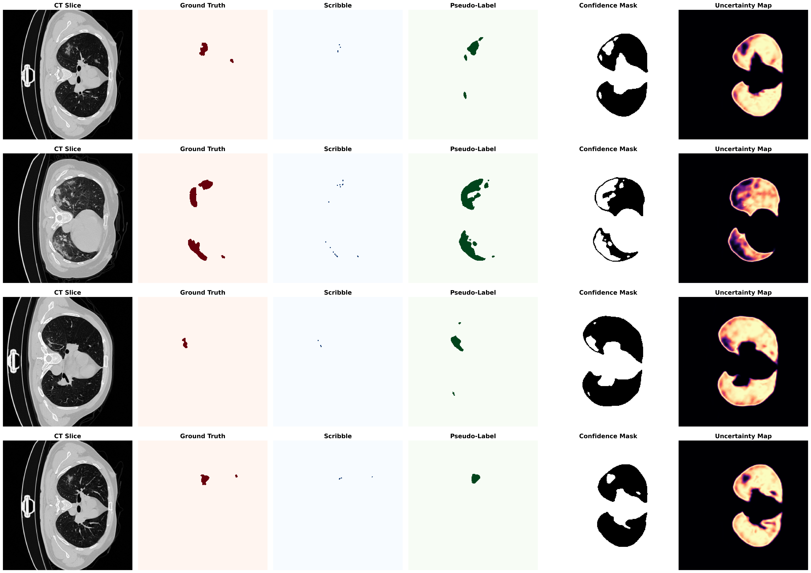

# CASR-Net
### Confidence-Aware Teacher-Guided Scribble Refinement for Pulmonary Infection Segmentation in Chest CT

CASR-Net is a teacher-assisted framework for segmenting pulmonary infection in chest computed tomography (CT). A segmentation teacher is first trained with **dense lesion annotations**. Its weights initialize a student, which is subsequently refined with simulated foreground/background scribbles, reliable teacher pseudo-labels, and soft teacher consistency. During inference, only the refined student is required.

> **Supervision scope.** This is **not** a dense-label-free or scribble-only end-to-end method. Dense lesion masks are used to prepare the teacher, and the experimental scribbles are simulated from available masks. The scientific question is whether confidence-aware sparse refinement adds value to a densely prepared teacher.



## Method at a glance

1. **Prepare a dense teacher.** Train a UNet++ model with an EfficientNet-B0 encoder from densely annotated chest CT images.
2. **Construct sparse annotations.** Sample positive infection scribbles and negative background scribbles from the training annotations.
3. **Estimate reliable regions.** Use the frozen teacher's probability maps, with a lung-region constraint where supported by the experimental protocol. The reference confidence thresholds are \(\tau_f=0.85\) for foreground and \(\tau_b=0.05\) for background; run-specific configurations must be checked before reproduction.
4. **Refine the student.** Initialize the student from the teacher and optimize with scribble supervision, confidence-selected hard pseudo-labels, and soft teacher guidance. Intermediate-confidence pixels are withheld from *hard* pseudo-label targets.
5. **Predict infection masks.** Use the student alone at test time. The four-view augmentation scheme uses the original, horizontal flip, vertical flip, and combined horizontal–vertical flip views; each prediction is returned to the original orientation before aggregation. An inference threshold is selected using validation data.

The principal reported 2.5-D input contains the central axial slice and its two neighboring slices, resized to **3 × 256 × 256**.

## Data sources and experimental partitions

The original studies use **distinct datasets and partitions**. Do not merge their indices, checkpoints, or metric tables.

| Experiment group | Kaggle dataset | Recorded partition | Branch / outputs |
|---|---|---|---|
| Original volumetric COVID-19 CT scans | [andrewmvd/covid19-ct-scans](https://www.kaggle.com/datasets/andrewmvd/covid19-ct-scans) | 18 cases; 2,858 retained slices; train 12 cases / 1,938 slices, validation 2 / 193, test 4 / 727 | `main`; `data/splits/`, `outputs/` |
| COVID-19 CT lesion segmentation collection | [maedemaftouni/covid19-ct-scan-lesion-segmentation-dataset](https://www.kaggle.com/datasets/maedemaftouni/covid19-ct-scan-lesion-segmentation-dataset) | 71 cases / 2,729 image–mask pairs; clean partition: train 49 / 1,864, validation 11 / 413, test 10 / 352, external 1 / 100 | `dataset-2-experiments`; `data/dataset2_covid_lesion/`, `outputs_dataset2_covid_lesion/` |
| MosMedData CT volumes | [mathurinache/mosmeddata-chest-ct-scans-with-covid19](https://www.kaggle.com/datasets/mathurinache/mosmeddata-chest-ct-scans-with-covid19) | An annotated subset; refer to the saved split CSVs for exact eligibility and partition size | `dataset-2-experiments`; `data/dataset2_mosmed/`, `outputs_dataset2/` |

The original 18-case configuration clips CT intensities to **[-1000, 400] HU** and resizes to **256 × 256**. The 71-case collection uses PNG image/mask pairs with its own preprocessing protocol and *does not use strict lung-mask restriction in its clean-split configuration*. These are separate protocols, not interchangeable implementations.

**Original protocol sources:** `configs/preprocessing_config.json`, `configs/tta_postprocessing_config.json`, `data/splits/*.csv`, and the per-dataset summaries under `outputs_dataset2*/reports/` on the `dataset-2-experiments` branch.

## Existing results and artifacts

The repository retains recorded metric tables, training logs, split metadata, visual analyses, and a selection of checkpoint files. A reported 18-case experiment summary lists **Dice = 0.804594** and **IoU = 0.716492** at a recorded inference threshold of **0.035**. Other experiments have different data partitions and evaluation settings; comparisons must keep dataset, split, checkpoint, threshold-selection rule, and metric aggregation consistent.

The current research work is reconstructing the scoring and model-provenance chain for reproducible, same-slice comparisons. **Do not assume a recovered visualization checkpoint is identical to the model that produced a reported aggregate score.** A checkpoint is used for quantitative comparison only after its identity and evaluation settings have been confirmed.

### Figures already available

| Visual evidence | Repository path |
|---|---|
| CT and simulated scribble examples | `outputs/figures/dataset/` |
| Confidence-selected pseudo-label examples | `outputs/figures/results/uncertainty_guided_pseudo_label_examples.png` |
| Teacher-guided pseudo-label examples | `outputs/figures/results/teacher_assisted_pseudo_label_examples_strict.png` |
| TTA-based qualitative predictions | `outputs/figures/results/tta_optimized_qualitative_predictions.png` |
| Lesion-focused Grad-CAM | `outputs/figures/results/casrnet_lesion_targeted_gradcam_visualization_no_dice.png` |

These historical figures do **not** by themselves establish a matched multi-model qualitative comparison.

## Reproducible qualitative-comparison study

Development branch: **[`casrnet-qualitative-comparison-2026`](https://github.com/itsCodeBakery/scribble-uncertainty-lung-segmentation/tree/casrnet-qualitative-comparison-2026)**.

The planned outputs are:

- **Figure A — Matched segmentation comparison:** identical held-out CT slices, reference infection masks, scribbles, and genuine predictions from U-Net, Attention U-Net, UNet++ teacher, scribble baselines, and CASR-Net.
- **Figure B — Challenging-case analysis:** pre-specified median and difficult lesion-positive cases with per-slice metrics and consistent prediction overlays.

For each compared method, preserve: source implementation/architecture citation, checkpoint identity and SHA-256, training split, preprocessing, model input dimensionality, threshold/postprocessing rule, per-case metrics, and raw probability/prediction masks. Baselines must be evaluated on the **same cases** before quantitative comparisons are drawn.

**Case selection rule:** select median and difficult cases using a documented, fixed metric and a common held-out split. Avoid subjective selection and do not alter masks for presentation.

**Research-data hygiene:** commit scripts, configuration files, split identifiers, CSV metrics, plots, and a manifest of source checkpoints. Do **not** upload patient CT volumes, private tokens, or large weight files into normal Git history. Store large binary artifacts through an appropriate external artifact store, with checksums and retrieval instructions.

## Getting started on Kaggle

1. Create a Python Kaggle notebook with a GPU and enable Internet access if available.
2. Attach the datasets listed above using **Add Input → Datasets**.
3. Clone this public repository:
   ```bash
   git clone --branch casrnet-qualitative-comparison-2026 \
     https://github.com/itsCodeBakery/scribble-uncertainty-lung-segmentation.git
   ```
4. Run the initial dataset/checkpoint audit. Do not begin training until split coverage and usable checkpoints have been identified.
5. When ready to push from Kaggle, add a scoped GitHub personal access token as a **Kaggle Secret** (for example `GITHUB_TOKEN`); never paste a token into notebook source or output.

Kaggle notebooks already supply many common scientific packages. See `requirements.txt` for the repository's baseline dependency list.

## Repository organization

```text
configs/                       Experiment-specific settings
data/splits/                   Original 18-case split metadata
outputs/                       Original metrics, figures, checkpoints
outputs_dataset2/              MosMedData experimental records (dataset-2 branch)
outputs_dataset2_covid_lesion/ COVID lesion experimental records (dataset-2 branch)
manuscript/                    Existing manuscript-related assets
requirements.txt
README.md
```

Some paths exist **only on the dataset-2 branch**. The public snapshot does not include a complete runnable set of original training notebooks/scripts, although older documentation referred to those folders. Restoration and validation are part of the reproducibility work.

## Evaluation and reporting

Evaluate overlap with Dice and IoU; sensitivity, specificity and precision for foreground/background behavior; and boundary metrics (e.g., HD95, ASSD) when their computation and empty-mask conventions are specified. Report whether scores are slice-wise, case-wise, micro-aggregated, or dataset-averaged. Threshold search and hyperparameter selection must use the validation partition, not the held-out test partition.

## Citation and status

**Manuscript in preparation** — *CASR-Net: Confidence-Aware Teacher-Guided Scribble Refinement for Pulmonary Infection Segmentation in Chest CT*.

```bibtex
@misc{casrnet_repo_2026,
  author = {Syed Shayan Ali Shah},
  title = {CASR-Net: Confidence-Aware Teacher-Guided Scribble Refinement for Pulmonary Infection Segmentation in Chest CT},
  year = {2026},
  howpublished = {GitHub repository},
  url = {https://github.com/itsCodeBakery/scribble-uncertainty-lung-segmentation}
}
```

### Ethics, licensing, and provenance

Public Kaggle datasets retain their own terms and attribution requirements. The MosMedData source has additional non-commercial/no-derivatives licensing conditions; inspect the original license before redistributing any derivative data. GitHub stores research metadata and code, not a substitute for the original dataset hosts.
